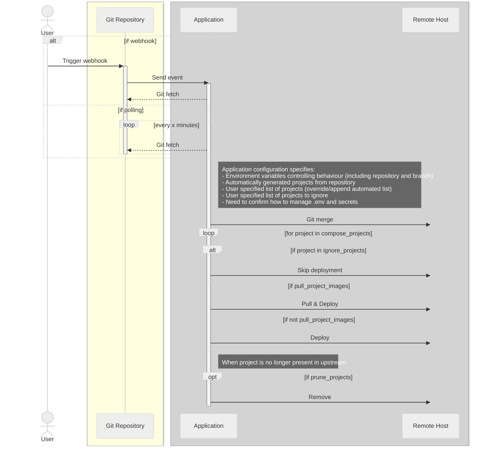

# compose-gitops

A GitOps tool that automates deployment of Docker Compose projects from a Git repository. It can be triggered by a GitHub Actions workflow (webhook) or by polling.

## Sequence Diagram Detailing Design



## Prerequisites (host)

To run `docker load` and `docker run` on the host you need permission to use the Docker daemon. If you see **permission denied** when running `docker load < result` or `docker run`, add your user to the `docker` group:

```bash
sudo usermod -aG docker "$USER"
```

Then **log out and log back in** (or run `newgrp docker` in the same terminal) so the new group takes effect. Verify with `docker info`.

## Behaviour (from sequence diagram)

- **Webhook**: GitHub (or any client) sends a POST to `/webhook` or `/sync` → application runs git fetch, then for each compose project: skip if ignored, else pull images (optional) and deploy.
- **Polling**: If `COMPOSE_GITOPS_POLL_INTERVAL` is set, the application periodically runs the same sync.
- **Prune**: If `COMPOSE_GITOPS_PRUNE_PROJECTS=true`, projects that were previously deployed but are no longer in the effective list (or removed from the repo) are brought down.

Compose operations (pull, up, down) use the [Docker Compose Go API](https://github.com/docker/compose) (v5), not the CLI, so the container does not need the `docker` or `docker-compose` binaries—only access to the Docker socket.

## Configuration (environment variables)

| Variable                         | Required | Description                                                                                                |
| -------------------------------- | -------- | ---------------------------------------------------------------------------------------------------------- |
| `COMPOSE_GITOPS_REPOSITORY`      | Yes      | Git repository URL (HTTPS or SSH).                                                                         |
| `COMPOSE_GITOPS_WORK_DIR`        | Yes      | Directory on the host for git clone and compose projects. Must be writable and persistent.                 |
| `COMPOSE_GITOPS_BRANCH`          | No       | Branch to track (default: `main`).                                                                         |
| `COMPOSE_GITOPS_POLL_INTERVAL`   | No       | Poll interval, e.g. `5m`. If unset, only webhook/HTTP triggers run sync.                                   |
| `COMPOSE_GITOPS_WEBHOOK_SECRET`  | No       | If set, webhook and `/sync` requests must include this (header `X-Webhook-Secret` or query `?secret=...`). |
| `COMPOSE_GITOPS_IGNORE_PROJECTS` | No       | Comma-separated project names to never deploy.                                                             |
| `COMPOSE_GITOPS_PROJECTS`        | No       | Override or append to auto-discovered projects (see `COMPOSE_GITOPS_APPEND_PROJECTS`).                     |
| `COMPOSE_GITOPS_APPEND_PROJECTS` | No       | If `true` or `1`, `COMPOSE_GITOPS_PROJECTS` is appended to discovered list; otherwise it replaces.         |
| `COMPOSE_GITOPS_PULL_IMAGES`     | No       | If `true` or `1`, pull images before deploy (default: `true`).                                             |
| `COMPOSE_GITOPS_PRUNE_PROJECTS`  | No       | If `true` or `1`, remove projects no longer in the effective list.                                         |
| `COMPOSE_GITOPS_HTTP_ADDR`       | No       | HTTP listen address (default: `:8080`).                                                                    |

## Development (Nix + direnv)

`flake.nix` provides a development shell (Go, gopls, delve, docker, docker-compose, golangci-lint, etc.). With [direnv](https://direnv.net/) and Nix flake support, run `direnv allow` in the repo; the `.envrc` uses `use flake` to load the dev shell automatically.

## Building the container image (Nix)

The image is built with **Nix** (NixOS/nixpkgs) for a minimal, reproducible, layered container—no Alpine or glibc base. The repo’s **`flake.nix`** provides the dev shell and the image; use `nix build .#docker` for the image or `nix build .#default` for the CLI.

**With Nix (recommended):**

```bash
cd compose-gitops
nix build .#docker
docker load < result
```

To build only the CLI binary: `nix build .#default`

On first build, if Nix reports a vendor hash mismatch, copy the suggested `got: sha256-...` value into `flake.nix` as `vendorHash` (in the `packages` section) and rebuild.

**Without Nix (Docker-only):** use the Dockerfile as a builder; see comments in `Dockerfile` for the exact `docker build` and `docker run` steps to produce the image tarball and load it.

## Running as a Docker container

You must **build and load the image first** (see above). Do **not** run `docker run .` — the image name is `compose-gitops:latest`, not the current directory.

On the target host (where Docker and compose projects will run):

```bash
# 1. Build and load the image (once)
nix build .#docker && docker load < result

# 2. Create a writable work directory on the host
sudo mkdir -p /data/compose-gitops
sudo chown "$(id -u):$(id -g)" /data/compose-gitops

# 3. Run the container (use the image name, not ".")
docker run -d --name compose-gitops \
  -v /var/run/docker.sock:/var/run/docker.sock \
  -v /data/compose-gitops:/data \
  -e COMPOSE_GITOPS_REPOSITORY=https://github.com/you/your-compose-repo \
  -e COMPOSE_GITOPS_WORK_DIR=/data \
  -e COMPOSE_GITOPS_WEBHOOK_SECRET=your-secret \
  -p 8080:8080 \
  compose-gitops:latest
```

Use a secret (e.g. from a vault or GitHub Actions secret) for `COMPOSE_GITOPS_WEBHOOK_SECRET` so only your workflow can trigger deployments.

### Permission denied when running the container

- **Permission denied when running `docker load` or `docker run` on the host** — Your user cannot access the Docker socket. See [Prerequisites (host)](#prerequisites-host): add your user to the `docker` group and log in again.
- **"permission denied" or "invalid reference"** — You must run the **built image**, not the project path. Use `compose-gitops:latest` as the image name after `docker load < result`. Running `docker run .` is invalid (`.` is not an image name).
- **Permission denied inside the container** (e.g. when syncing):
  - **Docker socket**: The container needs read/write access to the host’s Docker socket. Ensure `/var/run/docker.sock` is mounted (`-v /var/run/docker.sock:/var/run/docker.sock`). On the host, your user must be in the `docker` group (or run Docker as root) so the daemon accepts connections.
  - **Work directory**: The path you pass as `COMPOSE_GITOPS_WORK_DIR` (e.g. `/data`) is mounted from the host; the container must be able to read and write it (git clone, compose files, state file). Create the host directory and set ownership so the container’s user can write (e.g. `chown` to your user, or run the container with `--user` matching the host directory owner).

## Triggering from GitHub Actions

Trigger a sync after pushing to the compose repo by calling the webhook from a workflow.

Example workflow in the **compose repository** (e.g. `your-compose-repo`):

```yaml
name: Deploy

on:
  push:
    branches: [main]

jobs:
  trigger-deploy:
    runs-on: ubuntu-latest
    steps:
      - name: Trigger compose-gitops
        run: |
          curl -f -X POST \
            -H "X-Webhook-Secret: ${{ secrets.COMPOSE_GITOPS_WEBHOOK_SECRET }}" \
            "https://your-deploy-host:8080/webhook"
        env:
          COMPOSE_GITOPS_WEBHOOK_SECRET: ${{ secrets.COMPOSE_GITOPS_WEBHOOK_SECRET }}
```

Add `COMPOSE_GITOPS_WEBHOOK_SECRET` as a repository secret (same value as on the container). The deploy host must be reachable from GitHub (e.g. public URL or self-hosted runner on the same network).

For synchronous trigger and JSON result, POST to `/sync` instead of `/webhook` (same headers).

## Endpoints

- `GET /health` — returns 200 OK (for readiness/liveness).
- `POST /webhook` — triggers sync in background, returns 202 Accepted.
- `POST /sync` — triggers sync and returns 200 with JSON result (deployed, skipped, pruned, errors).

## Project discovery

Compose projects are directories that contain one of:

- `compose.yaml`
- `compose.yml`
- `docker-compose.yaml`
- `docker-compose.yml`

The repository root is scanned recursively; each such directory is one project (identified by its path relative to the repo root).

## Security notes

- Do not run the container as root unless required for Docker access; prefer Docker socket group or rootless Docker.
- Keep `COMPOSE_GITOPS_WEBHOOK_SECRET` strong and only in secrets.
- `.env` and secrets for compose projects are not managed by this tool; use your repo’s existing pattern (e.g. env files in repo or injected by the host).
